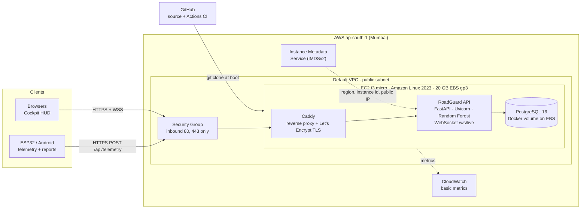

# RoadGuard on AWS: Cloud Computing Project

RoadGuard detects potholes and speed breakers from vehicle IMU data, remembers where they are, and warns
drivers before they reach them. This document covers the **cloud part**: how the v4 platform is packaged,
deployed and operated on **Amazon Web Services within the free tier**.

## 1. Objective

Take a laptop-only IoT + ML prototype and run it as an internet-facing cloud service that:

* accepts sensor telemetry and hazard reports from any device over HTTPS,
* classifies road condition in real time with a machine-learning model,
* stores the shared hazard map in a managed-style relational database,
* pushes live updates to every open dashboard, and
* costs nothing (or only free-tier credits) to run.

## 2. Architecture

**Request path:** client → Security Group → Caddy (TLS termination, compression, WebSocket upgrade) →
FastAPI app container → PostgreSQL container. The three containers are defined in
[`docker-compose.yml`](docker-compose.yml); the instance is configured entirely by
[`deploy/aws/user-data.sh`](deploy/aws/user-data.sh) through cloud-init.

## 3. Cloud concepts used

| Concept | Where it shows up |
| :--- | :--- |
| **IaaS** | EC2 virtual machine, EBS block storage, VPC networking |
| **Virtualisation vs. containerisation** | One VM (Nitro hypervisor) runs three isolated Docker containers with their own memory limits |
| **Infrastructure as code / automation** | cloud-init user data installs Docker, generates secrets and starts the stack; a systemd unit restarts it on every boot |
| **Elastic, disposable servers** | Terminate the instance and launch a new one with the same user data: the whole service comes back in about 6 minutes |
| **Instance metadata (IMDSv2)** | `start.sh` reads region, AZ, instance id/type and public IP with a session token; the dashboard's Cloud Node panel shows them |
| **Network security** | Security group allows only 80/443; SSH is closed; PostgreSQL and the API port are not published to the internet |
| **TLS / HTTPS** | Caddy obtains a free certificate for `<ip>.sslip.io` automatically and renews it |
| **Secrets management** | The database password is generated on the instance (`.env`, mode 600) and never stored in git |
| **CI/CD** | GitHub Actions runs the 29 tests and boots the full Docker stack on every push; `update.sh` pulls and redeploys |
| **Monitoring** | `/health` (DB, ML, device stream), `X-Response-Time-ms` header, request counters in `/api/info`, Docker health checks, CloudWatch CPU/network graphs |
| **Real-time cloud messaging** | WebSocket fan-out from the API to every connected dashboard |
| **Pay-as-you-go / free tier** | Sized to fit t3.micro (1 GB RAM + 2 GB swap, PostgreSQL tuned to 64 MB buffers) |

## 4. AWS services and cost

| Service | Use | Free-plan account (after 15 Jul 2025) | Legacy free tier (before 15 Jul 2025) |
| :--- | :--- | :--- | :--- |
| EC2 t3.micro | Runs the containers | Paid from the US$100–200 sign-up credits (~US$8/month) | 750 h/month free for 12 months |
| EBS gp3 20 GB | OS, Docker images, database | Credits (~US$2/month) | 30 GB free |
| Public IPv4 | Internet address | Credits (~US$3.6/month) | 750 h/month free |
| VPC, Security Group, IMDS | Networking, metadata | Free | Free |
| CloudWatch basic metrics | CPU, network, status checks | Free | Free |
| *Optional:* RDS PostgreSQL | Managed database instead of the container | Credits | 750 h/month db.t3.micro free |

Set a **zero-spend budget** in Billing → Budgets so AWS emails before any real charge.

## 5. Deploying

Step-by-step console guide: [`deploy/aws/README.md`](deploy/aws/README.md). In short:

1. EC2 → Launch instance in **ap-south-1**: Amazon Linux 2023, **t3.micro**, no key pair, allow HTTP + HTTPS, 20 GB gp3.
2. Paste [`deploy/aws/user-data.sh`](deploy/aws/user-data.sh) into **Advanced details → User data**.
3. Launch, wait ~6 minutes, open `http://<public-ip>/` or `https://<public-ip-with-dashes>.sslip.io/`.

## 6. Viva demo script (5 minutes)

1. **Cloud Node badge** (header) → show platform `AWS EC2`, region, instance id/type, PostgreSQL, uptime, live WebSocket clients.
2. Open the dashboard on a **phone and a laptop** at once. Click **Test Pothole** on one: the hazard, toast and classification appear on both instantly (WebSocket push).
3. **Classification Engine** card: Random Forest vs physics rules vs fused decision. Click **Test Breaker**: the physics rules say POTHOLE, the Random Forest says BREAKER, the fused decision is right.
4. **Simulate Approaching Hazard**: voice warning at ~100 m, impact detected, the server auto-stores it as a second observation of the same hazard (15 m de-duplication).
5. **Report Hazard** on the map from the phone, then **Mark Repaired** from the laptop.
6. **Analytics** (KPIs, 14-day chart) and **ML Metrics** (confusion matrix, real feature importances).
7. `/docs` (OpenAPI), `/health`, and the green GitHub Actions run (tests + Docker stack).
8. EC2 console: instance, security group (80/443 only), CloudWatch CPU graph.

## 7. Scaling beyond one instance

The free-tier design is a single VM. The path to production scale:

| Need | Change |
| :--- | :--- |
| Survive instance failure | Auto Scaling Group (min 1) behind an Application Load Balancer; health check on `/health/ready` |
| Durable, backed-up database | Amazon RDS PostgreSQL (Multi-AZ) via `DATABASE_URL`; the code already supports it |
| More than one API process | Move live telemetry state and WebSocket fan-out to Redis (ElastiCache) pub/sub; today they are in-process, so the API runs one worker |
| High-rate device ingest | AWS IoT Core (MQTT) or Kinesis in front of the API |
| Static assets close to users | S3 + CloudFront for the dashboard |
| Logs and alarms | CloudWatch agent for container logs, alarms on CPU, 5xx rate and `/health` |

## 8. Limitations (honest)

* The ML dataset is **synthetic**, so the 100 % test accuracy reflects separable simulated windows, not real roads.
* One EC2 instance is a single point of failure; data lives on its EBS volume (use `pg_dump` or RDS for backups).
* sslip.io HTTPS depends on a public DNS service and Let's Encrypt rate limits; plain HTTP on the IP always works.
* The Android app still uses its own Supabase backend; pointing it at this API is future work.
