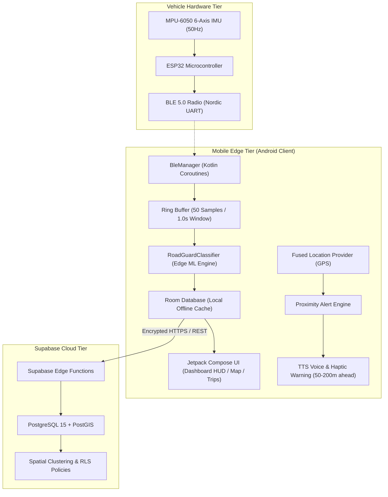
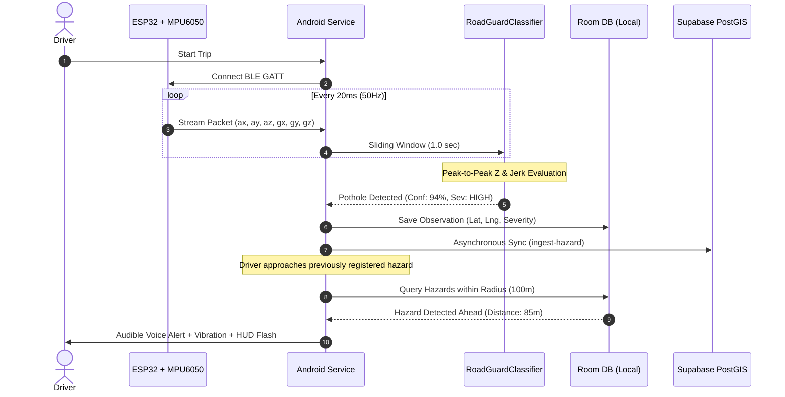

# RoadGuard System Architecture & Engineering Design

**Department of Computer Science & Engineering | IDEA Lab**  
**Ramdeobaba University, Academic Year 2026–27**  
**Project Guide:** Dr. Suresh Balpande  
**Team:** Bhoomi Magarde (A6-19), Mohammad Ejaz Mehendi (A6-25), Nidhish Dadhe (A6-53)

---

## 1. High-Level Architecture Overview

RoadGuard employs a four-tier hybrid edge-cloud architecture designed for high availability, low alert latency, and offline resilience:

---

## 2. Sequence Diagram: Real-Time Detection & Proximity Alerting

---

## 3. Edge Computing vs. Cloud Partitioning

| Subsystem Task | Execution Tier | Latency | Rationale |
| :--- | :--- | :--- | :--- |
| **Sensor Sampling (50Hz)** | ESP32 Embedded | < 1 ms | Hardware I2C timer interrupt avoids OS scheduling jitter. |
| **Sliding Window Feature Extraction** | Android Edge | 8 ms | Zero network dependency; immediate classification. |
| **Proximity Collision Warning** | Android Edge | < 15 ms | Drivers require immediate audio cues before road impact. |
| **Spatial Clustering & Deduplication**| Supabase Cloud | 200–500 ms | Combines crowdsourced reports from thousands of vehicles using PostGIS `ST_DWithin` & DBSCAN. |
| **Municipal Roughness Heatmaps** | Supabase Cloud | Periodic / Batch | High compute requirements for city-wide IRI analysis. |
